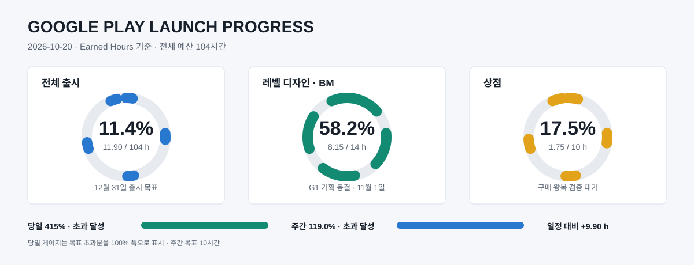
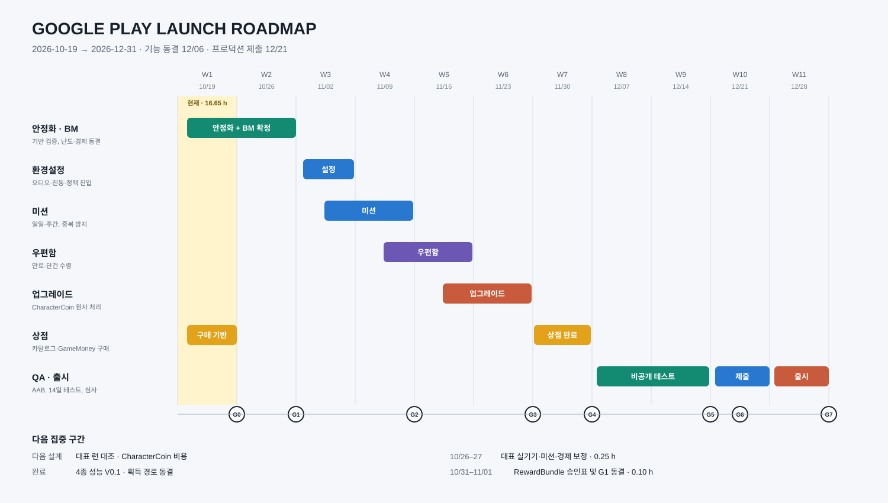

# LootUp Google Play 출시 로드맵

기간: 2026-10-19 ~ 2026-12-31
목표: UI 리뉴얼을 제외한 6개 작업과 출시 필수 공통 작업을 완료하고 Google Play 프로덕션 출시까지 진행한다.

## 1. 일정 기준

- 평일: 하루 1시간, 주 5시간
- 주말: 하루 2~3시간, 주 4~6시간
- 주간 가용 시간: 9~11시간
- 전체 계획 용량: 약 104시간
- 기능 완료 목표: 2026-12-06
- 비공개 테스트 및 안정화: 2026-12-07 ~ 2026-12-20
- 프로덕션 제출 목표: 2026-12-21
- 최종 출시 목표: 2026-12-31

Google Play 개인 개발자 계정이 2023-11-13 이후 생성된 경우를 보수적으로 가정해 최소 12명의 테스터가 14일 연속 참여하는 비공개 테스트 기간을 일정에 포함한다. 해당 요건이 적용되지 않으면 이 기간은 회귀 테스트와 심사 대응 버퍼로 전환한다.

## 2. 출시 범위 기준안

### 포함

1. 미션
2. 우편함
3. 업그레이드(강화)
4. 상점
5. 환경설정
6. 레벨 디자인 및 BM 설계
7. Android 통합 QA, Google Play 등록 및 심사 대응

### 제외 또는 후속 전환

- UI 리뉴얼 전면 작업은 `Docs/11_UI_CHANGE_BACKLOG.md`에 누적하고 11월 29일 범위 동결 후 일괄 적용 여부를 결정한다. 승인 전에는 104시간 예산에 포함하지 않는다.
- Ruby 현금 판매 상품과 Ninja 외 추가 소비처
- 다단계 이벤트 미션과 시즌 패스
- 우편함 푸시 알림과 운영 자동 발송 도구
- 상점 복수 패키지, 할인 로테이션과 복잡한 IAP 구성

### 출시 BM 기준안

- Ruby는 미션·이벤트·운영 보상으로 무료 축적하고 Ninja 1,200 Ruby 해금에 사용한다. 현금 판매는 후속으로 미룬다.
- 상점 V1은 GameMoney 기반 캐릭터 해금 또는 한정된 성장 상품으로 범위를 제한한다.
- 광고 BM은 배너와 런당 1회 보상형 부활을 우선 검토한다.
- 현금 IAP와 광고 제거 상품은 영수증 서버 검증까지 확보할 시간이 부족하면 출시 후 단계로 미룬다.

## 3. 시간 예산

| 작업 | 배정 시간 | 완료 기준 |
|---|---:|---|
| 선결 안정화 | 6시간 | Loadout, 버전 게이트, Pending Queue 핵심 검증 완료 |
| 레벨 디자인 및 BM | 14시간 | 경제 표, 보상 곡선, 광고 정책과 출시 범위 고정 |
| 환경설정 | 6시간 | BGM/SFX/진동 저장, 약관·개인정보·지원 진입 제공 |
| 미션 | 12시간 | 일일/주간 진행, 초기화, 보상 중복 방지 완료 |
| 우편함 | 10시간 | 목록·만료·수령 및 중복 수령 방지 완료 |
| 업그레이드 | 12시간 | CharacterCoin 비용, 강화 적용, 서버 동기화 완료 |
| 상점 | 10시간 | 서버 카탈로그, GameMoney 구매와 실패 복구 완료 |
| 통합 QA 및 출시 | 24시간 | AAB, 정책 문서, 비공개 테스트, 심사 대응 완료 |
| 예비 버퍼 | 10시간 | 심사 반려, 치명 버그와 일정 지연 대응 |
| 합계 | 104시간 | 12월 내 프로덕션 출시 |

## 4. 주차별 일정

| 주차 | 기간 | 목표 | 산출물 |
|---|---|---|---|
| 1주차 | 10/19~10/25 | 선결 안정화와 BM 초안 | Loadout·버전·동기화 검증, 캐릭터 구매 기반, 경제 원칙, 난도 V0.2 |
| 2주차 | 10/26~11/01 | 레벨/BM 확정 | 층별 난이도, 보상·소비 곡선, 미션·상점 보상표, 광고 정책 |
| 3주차 | 11/02~11/08 | 환경설정 완료, 미션 기반 | 설정 저장, 약관 진입, 미션 데이터 모델·진행 이벤트 |
| 4주차 | 11/09~11/15 | 미션 완료, 우편함 기반 | 일일/주간 미션, 보상 멱등성, 우편 데이터 계약 |
| 5주차 | 11/16~11/22 | 우편함 완료, 강화 연결 시작 | 목록·만료·수령, 서버 검증, 강화 UI 연결 |
| 6주차 | 11/23~11/29 | 업그레이드 완료 | CharacterCoin 차감·강화 원자 처리, 재접속 복구 |
| 7주차 | 11/30~12/06 | 상점 완료 및 기능 동결 | GameMoney 상점, 카탈로그·구매 원장, 승인된 UI 일괄 리뉴얼 후보, Feature Complete 빌드 |
| 8주차 | 12/07~12/13 | 비공개 테스트 1주차 | 12명 이상 테스트 시작, API 36/AAB, 기기별 회귀 수정 |
| 9주차 | 12/14~12/20 | 비공개 테스트 2주차 | 14일 유지, 크래시·ANR·광고·데이터 복구 점검 |
| 10주차 | 12/21~12/27 | 프로덕션 신청과 심사 대응 | 프로덕션 액세스 신청, 스토어 등록, 심사 제출 및 수정 빌드 |
| 11주차 | 12/28~12/31 | 출시 버퍼 | 심사 반려 대응, 최종 단계적 출시, 운영 체크 |

### 4.1 레벨 디자인 및 BM 세부 일정

`DESIGN` 총예산은 14시간이다. 2026-10-22 현재 XP V0.2, 출시 캐릭터 운영 주기와 4종 성능·획득 경로 V0.1 검증까지 12.90시간을 획득했으며 잔여 1.10시간을 G1 기획 동결일인 11월 1일까지 배치한다.

| 기간 | 작업 | 배정 | 상태·완료 기준 |
|---|---|---:|---|
| 10/19 | BM V0.1, Ruby 소비 후보, 난도 V0.2, 그래프, 문서·로드맵 시각화 | 4.25시간 | 완료 |
| 10/20 | 난도 런타임·성장 감사·Editor 시뮬레이터·V1.1 예약 | 3.90시간 | 완료, 20,000회 검증과 후속 성장 명세 확정 |
| 10/21~10/22 | 시뮬레이터 V1.1 최우선 구현 | 2.00시간 | 완료, Editor 시각 확인과 Ninja 60,000런 재계산 통과 |
| 10/21~10/22 | 전체 캐릭터 성장 비교·통합 내보내기 | 0.50시간 | 완료, 캐릭터 4종 총 240,000런 재계산 통과 |
| 10/22 | XP V0.2 역할·성장 정책·보상 곡선 | 1.00시간 | 완료, 4종 240,000런 Lv.20 P50 154~171회 확인 |
| 10/22 | 초기 캐릭터 수·라이브 추가 주기 | 0.50시간 | 완료, 출시 4종·예비 1종·D+28~35 첫 추가·이후 6~8주 |
| 10/22 | 캐릭터 성능 허용선·획득 경로 V0.1 | 0.75시간 | 완료, 2차 240,000런 P50 Agent X 18F·Landy 22F·Alice 23F·Ninja 24F |
| 10/26~10/27 | 대표 Editor·APK 런 및 미션·경제 보정 | 0.25시간 | 성장 결과 병목 구간과 주간 수지 대조 |
| 10/28 | CharacterCoin 강화 비용 및 획득 곡선 확정 | 0.50시간 | 강화 5단계 비용·기간 확정 |
| 10/29 | 광고 위치·빈도·부활 정책 확정 | 0.25시간 | 강제 전면 광고 제외 및 보상형 기준 승인 |
| 10/31~11/01 | 공통 `RewardBundle`, 승인표와 G1 문서 동결 | 0.10시간 | 마스터 기획·기능 명세·로드맵 일치 |

캐릭터 획득 실행 기반 1.5시간은 `SHOP` 예산으로 계측하며, 미보유 계정 구매·재로그인·중복 차감 수동 검증 0.5시간 완료 후 2.0시간 `Done`으로 전환한다.
1주차 현재 실적은 16.65시간으로 계측 기준 목표 10시간을 6.65시간 초과했다. 다음 DESIGN 작업은 대표 Editor·APK 런 대조와 CharacterCoin 강화 비용 확정이며 SHOP 왕복 검증은 2주차 이후로 유지한다.

### 4.2 일정 및 진척 시각화

아래 수치는 `Docs/09_RELEASE_PROGRESS_LOG.csv`의 획득 작업량을 기준으로 하며, 2026-10-22 캐릭터 성능·획득 경로 V0.1 최종 검증분까지 포함한다.

- 진척률 게이지는 전체 104시간, `DESIGN` 14시간, `SHOP` 10시간 예산을 각각 분모로 사용한다.
- 일정표의 노란 세로 영역은 현재 주차이며, 하단 `G0`~`G7`은 6절의 출시 게이트와 대응한다.
- 최신 수치의 단일 원본은 `Docs/09_RELEASE_PROGRESS_LOG.csv`이며 일정 변경 시 그래프와 표를 함께 갱신한다.

### 4.3 UI 변경 누적 및 일괄 리뉴얼

- 기능 개발 중 발생하는 UI 변동은 `Docs/11_UI_CHANGE_BACKLOG.md`에 기능별로 누적한다.
- 11월 23~29일에 필수·출시 후 항목과 작업량을 동결한다.
- 승인된 필수 UI는 11월 30일~12월 6일에 일괄 적용하고 비공개 테스트에서 회귀 검증한다.
- UI 작업량은 범위 승인 전까지 출시 획득 작업량에 포함하지 않으며, 12월 6일 기능 동결을 위협하면 전면 리뉴얼을 출시 후로 전환한다.

## 5. 기능별 완료 조건

### 미션

- 출시 시 일일 3종, 주간 3종 이하로 제한한다.
- 런 종료, 층 도달, 아이템 획득처럼 이미 존재하는 이벤트에서 진행도를 갱신한다.
- 서버 시각 기준 초기화와 `requestId` 기반 보상 중복 방지를 적용한다.
- 진행 중, 완료, 수령 완료, 만료 상태를 구분한다.

### 우편함

- 제목, 본문, 보상, 생성일, 만료일, 수령 상태를 제공한다.
- 일괄 수령은 출시 후로 미루고 단건 수령을 우선한다.
- 동일 우편 보상은 서버에서 한 번만 지급되도록 처리한다.
- 네트워크 실패 시 수령 상태를 확정하지 않고 재시도할 수 있어야 한다.

### 업그레이드

- 기존 `CharacterUpgradeDefinition`과 CharacterCoin 저장 기반을 활용한다.
- 비용 차감과 강화 레벨 증가는 하나의 서버 처리 단위로 묶는다.
- 현재 단계, 다음 단계 효과, 비용 부족, 최대 단계를 표시한다.
- 다음 InGame 진입 시 강화 능력치가 실제 적용되는지 검증한다.

### 상점

- 출시 V1은 소수의 GameMoney 상품만 사용한다.
- 신규 계정은 Agent X만 기본 보유하고 Landy 2,500 GameMoney, Alice 광고 5회, Ninja 1,200 Ruby 경로를 제공한다.
- Ninja에는 GameMoney 대체 경로를 두지 않으며 Ruby는 미션·이벤트·운영 보상으로도 축적할 수 있게 한다.
- SHOP 단계에서 독립 구매 버튼, 구매 확인, 현재·구매 후 잔액, 처리 중·성공·실패·잔액 부족·오프라인 상태를 완성한다.
- 현재 START 버튼을 UNLOCK으로 전환하는 임시 UI만으로는 SHOP 완료로 판정하지 않는다.
- 기존 계정의 캐릭터 보유권은 회수하지 않는다.
- 상품 정의와 가격은 서버 카탈로그 또는 교체 가능한 데이터 계층에서 관리한다.
- 캐릭터 구매는 재화 프로필, 재화 원장과 보유권을 하나의 BackND 트랜잭션으로 처리한다.
- 2026-10-19 기준 실행 기반과 Lobby 잠금 UI는 구현 완료했으며 수동 왕복 검증이 남아 있다.
- Landy와 Ninja 실제 계정 왕복 검증은 최소 구매 UI 구현 후 수행한다.
- Ninja Ruby 해금은 노출하되 현금 Ruby 판매와 기타 현금 IAP는 별도 승인 전까지 노출하지 않는다.

### 환경설정

- BGM, SFX, 진동 설정을 즉시 적용하고 재접속 후 복원한다.
- 개인정보처리방침, 이용약관, 고객지원 진입점을 제공한다.
- 계정 ID/닉네임/앱 버전 정보를 확인할 수 있게 한다.
- 로그아웃은 기존 로그인 흐름과 저장 데이터 경계를 유지한다.

### 레벨 디자인 및 BM

- 10층 단위 난이도, 적·아이템·RISING 확률과 보상 증가 곡선을 표로 고정한다.
- 난도는 30층 상승 후 10층 회복하는 40층 주기로 구성하고 Enemy 7개, Red Line 4개를 상한으로 둔다.
- GameMoney 획득원과 캐릭터 해금·상점 소비처의 주간 수지를 계산한다.
- 신규 사용자의 30분, 3일, 7일 목표를 정의한다.
- 광고 빈도는 플레이 중 강제 중단을 피하고 보상형 선택을 우선한다.

## 6. 출시 게이트

| 게이트 | 기한 | 통과 조건 |
|---|---|---|
| G0 기반 안정화 | 10/25 | 현재 유보 검증과 버전 게이트 핵심 경로 완료 |
| G1 기획 동결 | 11/01 | 경제·보상·BM·기능 범위 승인 |
| G2 1차 기능 | 11/15 | 환경설정과 미션 완료 |
| G3 서버 기능 | 11/29 | 우편함과 강화 완료 |
| G4 기능 동결 | 12/06 | 상점 포함 Feature Complete AAB 생성 |
| G5 테스트 종료 | 12/20 | 치명 버그 0건, 데이터 손실 0건, 요구 시 12명·14일 충족 |
| G6 프로덕션 제출 | 12/21 | 스토어·정책·AAB 제출 완료 |
| G7 출시 | 12/31 | 심사 승인 및 프로덕션 배포 완료 |

## 7. 출시 공통 체크리스트

- [ ] Android Target API 36 이상으로 빌드된 AAB 확인
- [ ] 앱 서명, versionName, versionCode 증가 규칙 확정
- [ ] 개인정보처리방침 공개 URL 및 앱 내 링크 등록
- [ ] Data safety, 광고 포함 여부, 대상 연령, 콘텐츠 등급 작성
- [ ] 심사 계정과 로그인 접근 방법 제공
- [ ] 내부 테스트 후 비공개 테스트 트랙 배포
- [ ] 적용 대상이면 최소 12명·14일 연속 참여 충족
- [ ] ANR, 크래시, 로그인, 저장 복구, 구버전 차단 검증
- [ ] 서버 장애와 네트워크 단절 시 재시도·중복 지급 방지 검증
- [ ] 단계적 출시 및 긴급 차단 버전 정책 준비

## 8. 일정 방어 규칙

- 작업이 8시간 이상 밀리면 주간 미션 종류, 우편함 일괄 수령, 상점 추가 상품부터 축소한다.
- 데이터 멱등성, 계정 분리, 구버전 차단, 개인정보·스토어 정책, 실기기 QA는 축소하지 않는다.
- 12월 6일 이후에는 신규 기능을 추가하지 않고 치명 버그와 출시 차단 항목만 수정한다.
- 매주 일요일 종료 시 실제 사용 시간, 완료율, 다음 주 범위를 이 문서와 작업 로그에 갱신한다.

## 9. Google Play 기준 자료

- [신규 개인 계정 테스트 요구사항](https://support.google.com/googleplay/android-developer/answer/14151465)
- [앱 심사 준비](https://support.google.com/googleplay/android-developer/answer/9859455)
- [앱 게시와 심사 상태](https://support.google.com/googleplay/android-developer/answer/9859751)
- [Target API 요구사항](https://support.google.com/googleplay/android-developer/answer/11926878)

## 10. 진척 계측

- 작업별 실적 원장: `Docs/09_RELEASE_PROGRESS_LOG.csv`
- 운영 및 판정 기준: `Docs/09_RELEASE_PROGRESS_TRACKER.md`
- 자동 계산 명령: `Tools/Measure-ReleaseProgress.ps1`
- 누적 출시 진척률은 완료된 획득 작업량을 전체 104시간으로 나누어 계산한다.
- 일정 준수율은 기준일까지 계획된 누적 시간 대비 실제 누적 획득 작업량으로 계산한다.
- 매 작업 시작 시 예상 작업량을 넣어 완료 후 예상 당일 달성률을 확인하고, 종료 시 실제 획득 작업량으로 다시 계산한다.

### 2026-10-22 기준 현황

- 전체: 16.65 / 104시간, 16.0%
- `DESIGN`: 12.90 / 14시간, 92.1%
- `SHOP`: 1.75 / 10시간, 17.5%
- 캐릭터 구매는 구현·컴파일 완료, 실제 계정 왕복 검증 대기 상태다.
- 캐릭터 성능 V0.1 2차 통합 결과는 Agent X 18F, Landy 22F, Alice 23F, Ninja 24F다. 전 캐릭터가 역할별 허용선을 통과해 현재 수치를 V0.1 기준으로 동결했다.
- 획득 경로는 Agent X 기본, Landy 2,500 GameMoney, Alice 광고 5회, Ninja 1,200 Ruby로 확정했다. Alice 광고 실행과 Ruby 무료 수급은 후속 구현이 필요하다.
- 초기 캐릭터는 공개 4종으로 동결하고 예비 1종을 준비한다. 첫 신규 캐릭터는 D+28~35, 이후 6~8주 주기로 추가하며 첫 6개월은 3종 추가를 상한으로 둔다.
