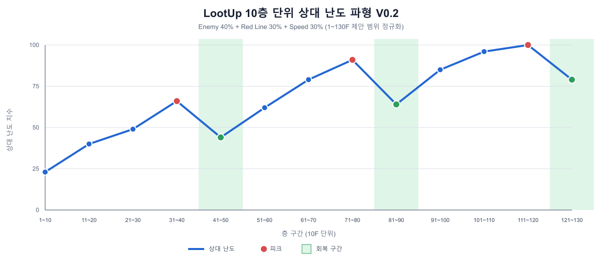

# LootUp 레벨 디자인 및 BM 기준안 V0.1

작성일: 2026-10-19
상태: 1차 검토 초안
목표: 강화, 미션, 우편함, 상점과 광고가 동일한 난이도·경제·보상 기준을 사용하도록 출시 V1의 기준선을 정의한다.

## 1. 의사결정 상태

- `확정`: 기존 구현 또는 이미 승인된 정책으로 유지한다.
- `초안`: 플레이 테스트와 사용자 승인 후 조정할 수치다.
- `유보`: 출시 필수 범위에서 제외하며 구현하지 않는다.

## 2. 출시 V1 원칙

### 확정

- 런은 10층 단위 페이지를 계속 사용하는 무한 상승 구조다.
- 일반 런 보상 재화는 GameMoney만 사용한다.
- CharacterCoin은 해당 캐릭터의 강화 재료로 사용한다.
- Ruby는 최초 출시에서는 서버 잔액, 원장, Pending Queue 기반만 유지하고 상품·획득·소비를 숨긴다. 후속 업데이트용 소비 설계는 9.1절을 기준으로 준비한다.
- 강제 전면 광고는 출시 V1에서 사용하지 않는다.
- 보상형 광고는 사용자가 선택하는 런당 1회 부활에 우선 사용한다.
- 광고 SDK는 게임 상태와 UI에서 직접 호출하지 않고 서비스 인터페이스 뒤에 둔다.

### 초안

- 기본 90초 런에서 신규 사용자가 10~20층을 경험하는 것을 1차 목표로 한다.
- 30분 안에 3~5회 플레이, 20층 도달, 첫 Artifact 확인 중 2개 이상을 경험하게 한다.
- 3일 안에 첫 CharacterCoin 강화 1~2단계를 완료하게 한다.
- 7일 안에 비기본 캐릭터 1명 해금 또는 주력 캐릭터 강화 3단계를 목표로 한다.

## 3. 현재 난이도 기준선

아래 표는 신규 구현안이 아니라 현재 코드 기본값을 정리한 기준선이다.

| 층 구간 | 페이지 | Enemy 수 | 위험 라인 수 | Enemy 속도 보정 | 역할 |
|---|---:|---:|---:|---:|---|
| 1~10F | 1 | 4 | 0 | +0 | 조작 학습 |
| 11~20F | 2 | 5 | 1 | +18 | 위험 라인 소개 |
| 21~30F | 3 | 6 | 1 | +36 | 첫 Artifact 보장 구간 |
| 31~40F | 4 | 7 | 2 | +54 | 기본 숙련 확인 |
| 41~50F | 5 | 7 | 2 | +72 | 속도 압박 시작 |
| 51~60F | 6 | 7 | 3 | +90 | 복합 회피 구간 |
| 61~70F | 7 | 7 | 3 | +108 | 고난도 진입 |
| 71F 이상 | 8+ | 7 | 최대 4 | 페이지당 +18 | 장기 기록 경쟁 |

현재 관련 기본값:

- 페이지당 일반 아이템 최대 6개
- RISING 출현 기본 확률 12%, 실패할 때마다 +3%, 일반 최대 45%
- 중복 보정 포함 RISING 최대 확률 70%, 8번째 유효 시도 보장
- RISING 완성 시 다음 10층 페이지의 첫 층으로 이동
- 첫 Golden Cup은 3번째 페이지에서 보장

### 1차 조정 원칙

- 1~20F는 학습 구간이므로 적 수보다 위험 라인의 가독성을 우선한다.
- Enemy 수는 31F에서 최대치에 도달하므로 이후 난이도는 속도만 계속 올리지 않고 위험 라인, 아이템 선택 압박과 패턴 조합으로 확장한다.
- RISING은 실패 누적 보장을 유지해 운이 나쁜 런에서도 시스템을 경험할 수 있게 한다.

### 테트리스 난도 설계 참고

- 라이선스 테트리스 매뉴얼은 10라인마다 다음 레벨로 넘어가며 낙하 속도가 증가하는 구조를 사용한다. LootUp의 10층 단위 난도 구간도 플레이어가 예측 가능한 짧은 마일스톤으로 유지한다.
- `Tetris Effect`의 Marathon/Master도 지속 또는 10라인 단위 속도 상승을 사용하지만, Zone은 낙하를 잠시 멈춰 플레이어가 압박을 정리할 시간을 준다.
- Tetris 플레이 데이터 연구에서는 속도만 끊임없이 상승할 경우 짧은 수행 정체 뒤 빠르게 게임이 끝나 기술 학습 기회가 제한될 수 있다고 설명한다.
- 따라서 LootUp은 장기적으로 난도가 상승하되, **30층 상승 후 10층 회복**을 주는 톱니형 파형을 사용한다. RISING의 시간 정지는 플레이어가 획득해 발동하는 능동적 완충 장치이고, 회복 구간은 모든 플레이어에게 보장되는 구조적 완충 장치로 구분한다.

참고 자료:

- Tetris Instruction Manual: https://service.mattel.com/instruction_sheets/I1024.pdf
- Tetris Effect Beginner's Community Guide: https://www.tetriseffect.game/beginners-community-guide/
- Measuring Tetris Players' Performance: https://onlinelibrary.wiley.com/doi/full/10.1111/tops.12575

### 제안 난도 파형 V0.2

| 층 구간 | 구간 역할 | Enemy 목표 | Red Line 목표 | 속도 보정 | 지원 아이템 보정 | 비고 |
|---|---|---:|---:|---:|---:|---|
| 1~10F | 학습 | 4 | 0 | +0 | 기준 | 이동, 엘리베이터, 아이템 학습 |
| 11~20F | 상승 1 | 5 | 1 | +12 | 기준 | Red Line 최초 노출 |
| 21~30F | 상승 2 | 6 | 1 | +24 | 기준 | 적 밀도 상승 |
| 31~40F | 피크 1 | 7 | 2 | +36 | 기준 | 첫 장기 생존 관문 |
| 41~50F | 회복 1 | 5 | 1 | +24 | x1.25 | 빈 이동 경로와 자원 회복 제공 |
| 51~60F | 상승 3 | 6 | 2 | +42 | 기준 | 이전 피크보다 높은 속도로 재개 |
| 61~70F | 상승 4 | 7 | 3 | +54 | 기준 | Red Line 판단 비중 확대 |
| 71~80F | 피크 2 | 7 | 4 | +66 | 기준 | 최대 Red Line 밀도 첫 적용 |
| 81~90F | 회복 2 | 6 | 2 | +48 | x1.25 | 난도는 낮추되 첫 회복보다 높게 유지 |
| 91~100F | 상승 5 | 7 | 3 | +72 | 기준 | 고난도 재진입 |
| 101~110F | 상승 6 | 7 | 4 | +84 | 기준 | 적 수보다 속도와 경로 압박 중심 |
| 111~120F | 피크 3 | 7 | 4 | +96 | 기준 | 상위 숙련 구간 |
| 121~130F | 회복 3 | 6 | 3 | +72 | x1.25 | 장기 플레이 보상 구간 |

### 난도 파형 그래프

그래프의 상대 난도 지수는 실제 플레이 결과가 아니라 설계안을 비교하기 위한 지표다. 1~130F 제안 범위에서 `Enemy 40% + Red Line 30% + 속도 30%`로 정규화했으며, 초록색 영역은 41~50F, 81~90F, 121~130F의 회복 구간을 나타낸다.

| 층 구간 | 1~10 | 11~20 | 21~30 | 31~40 | 41~50 | 51~60 | 61~70 | 71~80 | 81~90 | 91~100 | 101~110 | 111~120 | 121~130 |
|---|---:|---:|---:|---:|---:|---:|---:|---:|---:|---:|---:|---:|---:|
| 상대 난도 지수 | 23 | 40 | 49 | 66 | 44 | 62 | 79 | 91 | 64 | 85 | 96 | 100 | 79 |

해석 기준:

- 빨간 점은 각 주기의 피크이며, 초록 점은 피크 직후의 회복 지점이다.
- 회복 시 난도는 직전 피크보다 약 22~27포인트 낮아지지만 이전 회복 지점 `44 -> 64 -> 79`보다 계속 높아진다.
- 실제 플레이 테스트 후 체감 난도와 지수가 다르면 가중치를 바꾸기보다 Enemy, Red Line, 속도 원본 수치를 먼저 조정한다.

### 130F 이후 확장 규칙

- `상승 -> 상승 -> 피크 -> 회복`의 40층 주기를 반복한다.
- Enemy는 7을 상한으로 유지하고, 회복 구간에는 직전 피크보다 1마리 줄인다.
- Red Line은 4를 상한으로 유지하고, 회복 구간에는 직전 피크보다 1~2개 줄인다.
- 속도는 주기마다 기준선을 높이되, 회복 구간은 직전 피크보다 `-24`를 적용한다. 이전 회복 구간보다는 반드시 빠르게 유지한다.
- 지원 아이템 보정은 Time, Fever 충전 등 생존 보조 계열의 출현 가중치에만 적용한다. RISING 알파벳 확률과 보장 횟수는 별도 밸런스 축으로 유지한다.
- 회복 구간에서도 층 보상은 줄이지 않는다. 난도를 넘긴 직후 숨을 고르면서 다음 상승에 필요한 자원을 확보하는 보상 구간으로 사용한다.

### 캐릭터 성장 반영 기준

현재 XP 레벨은 필요 XP, 런 XP와 스킬 해금에 사용되며 이동속도·MaxLife·Item Chance를 레벨마다 연속 상승시키지는 않는다. 별도의 캐릭터 강화 코드는 이동속도, MaxLife, 즉시 획득 확률과 수집 확률을 보정할 수 있지만 실제 강화 에셋과 확정 수치가 없어 현재 난도 V0.2에는 적용하지 않는다.

스테이지 난도는 플레이어 레벨에 따라 실시간으로 강해지지 않는 고정 곡선을 유지한다. 성장 보상을 상쇄하는 동적 스케일링은 사용하지 않으며, 아래 기준군 모두에서 진행이 막히지 않는지를 샘플 런으로 검증한다.

| 층 구간 | 주 검증 기준군 | 설계 통과 조건 |
|---|---|---|
| 1~50F | Agent X Lv.1, 무강화, 스킬 미해금 | 기본 조작과 일반 아이템만으로 통과 가능 |
| 51~90F | Agent X Lv.5 스킬 해금 및 각 캐릭터 Lv.1 | 스킬은 생존 여유를 주지만 필수 조건이 아님 |
| 91~130F | 각 캐릭터 스킬 해금 기준 Lv.5·15·20, 무강화 | 캐릭터 선택에 따른 장단점은 허용하되 무강화 하드월 금지 |
| 131F 이상 | 스킬 해금 캐릭터와 향후 강화 단계 비교 | 무한 모드의 점진적 한계 구간으로 운영 |

- Agent X, Landy, Alice, Ninja는 기본 이동속도, 피벗 쿨타임, MaxLife와 Item Chance가 다르므로 동일 층 구간을 캐릭터별로 최소 1회 비교한다.
- 향후 강화 수치가 확정되면 `무강화 / 중간 강화 / 최대 강화` 3개 기준군을 추가하고, 최대 강화가 무강화보다 목표 도달 층을 얼마나 높이는지 별도 지표로 관리한다.
- 강화 없이 특정 층을 넘을 수 없는 구조는 사용하지 않는다. 강화는 생존 여유와 기록 향상 수단이며 기본 콘텐츠 입장 조건이 아니다.
- 샘플 런 전에는 Enemy·Red Line·속도 값을 추정으로 다시 조정하지 않는다. 기준군별 최고 층, 피격 수, 잔여 시간과 지원 아이템 획득 수를 수집한 뒤 V0.3 수치를 결정한다.

### 구현 방향

- `DifficultyBandDefinition`과 `DifficultyBandsV02` 에셋으로 Enemy 수, Red Line 수, 속도 보정과 지원 아이템 가중치를 10층 단위로 분리했다.
- `TestEnemySpawner`는 난도 에셋이 연결되면 밴드 값을 우선 사용하고, 참조가 없으면 기존 증가 공식을 폴백으로 유지한다.
- 130F 이후에는 91~130F의 `상승 -> 상승 -> 피크 -> 회복` 파형을 반복하고 주기마다 속도 보정 `+12`를 추가한다.
- `ItemSpawner`는 현재 층의 난도 밴드를 `ItemSpawnPolicy`에 전달하고 일반 드롭 추첨에서 `Time`과 `Fever`의 가중치에만 지원 아이템 배율을 적용한다.
- 회복 구간 `x1.25`에서는 현재 테이블 기준 `Time Chip` 가중치가 `35 -> 44`, `Fever Battery`가 `18 -> 23`으로 반올림된다. 강제 테스트, Item Chance 보장, Collection과 RISING 경로는 변경하지 않는다.
- V0.2 수치는 에디터 플레이 3회와 APK 플레이 3회를 기준으로 31~40F, 41~50F, 71~80F, 81~90F의 체감 차이를 우선 검증한다.
- 51F 이후 과도하게 어려우면 Enemy 상한보다 속도 보정을 먼저 `-6~-12` 범위에서 조정한다.

### Editor 레벨 밸런스 시뮬레이터

`Tools > LootUp > Level Balance Simulator`에서 실제 난도 에셋, `Items.csv`와 캐릭터 데이터를 불러와 캐릭터당 1,000·5,000·10,000회의 가상 런을 실행한다. 시뮬레이션은 실제 플레이와 APK 검증을 대체하지 않고, 후보 수치를 빠르게 압축한 뒤 대표 구간만 실기기에서 확인하는 1차 분석 도구로 사용한다.

- 입력: 난도 밴드, 아이템 테이블, 캐릭터, 레벨, 숙련도 가정, 반복 횟수, 최대 층과 난수 Seed
- 대시보드: P10·P50·P90 최고 층, HP 종료율, 시간 종료율, 완주율, 평균 피격·지원 아이템·GameMoney·RISING 발동 수
- 그래프: 10층 밴드별 압박 지수와 조건부 통과율, 층별 생존 곡선
- 비교: 전체 캐릭터를 동일 Seed·숙련도·레벨로 실행해 최고 층 분포와 종료 원인을 나란히 비교
- 경고: 통과율 급락, 회복 구간 역전, P50 조기 정체를 자동 표시
- 내보내기: `Docs/BalanceReports/<생성시각>/`에 설정 JSON, 전체 런 CSV, 밴드 CSV, Markdown 요약과 SVG 생존 곡선을 저장

결과 분석은 `configuration.json`, `run-results.csv`, `band-summary.csv`를 Codex에 전달해 밴드별 병목, 캐릭터 격차, 지원 아이템 과다·부족과 V0.3 조정 후보를 산출한다. 동일 Seed와 설정 파일을 보존해 수치 변경 전후를 재현 가능하게 비교한다.

시뮬레이션 가정값은 에디터의 `가정값` 접이식 영역에 모두 노출한다. 현재 모델은 이동·엘리베이터 시간, 적 수·Red Line·속도, 아이템 획득, 피버와 RISING을 확률 모델로 근사하므로 충돌 판정, 조작 실수, 프레임 드롭과 체감 가독성은 대표 Editor·APK 런에서 별도로 확인한다.

#### 1차 비교 리포트 결과

2026-10-20 Standard, Lv.1, 캐릭터당 5,000회, 130F, Seed `20261020` 조건으로 전체 캐릭터 비교를 실행했다. 총 20,000개 런과 52개 밴드 행, 설정·요약·생존 곡선이 `Docs/BalanceReports/2026-10-20_205047`에 저장됐으며 원본 CSV 재계산값과 요약이 일치했다.

| 캐릭터 | 평균 최고 층 | P10 | P50 | P90 | HP 종료 | 시간 종료 | 50F 도달률 |
|---|---:|---:|---:|---:|---:|---:|---:|
| Alice | 28.4 | 23 | 26 | 38 | 10.5% | 89.5% | 2.16% |
| Agent X | 19.0 | 17 | 17 | 24 | 9.3% | 90.7% | 0.00% |
| Landy | 22.9 | 19 | 21 | 29 | 2.8% | 97.2% | 0.20% |
| Ninja | 34.1 | 19 | 32 | 51 | 37.0% | 63.0% | 11.90% |

- 네 캐릭터 모두 130F 완주율은 0%이며 종료 원인은 대부분 시간 종료다. 현 모델에서 Lv.1 진행 한계는 적 난도보다 `90초 초기 시간 + 이동속도`의 영향을 크게 받는다.
- Agent X는 P50 17F, Ninja는 P50 32F로 기본 이동속도 차이가 도달 층 격차로 직접 연결된다. 캐릭터 선택이 기록 성능 격차로 고착되는지 대표 실플레이로 우선 검증한다.
- 1차 조정 전 Agent X 11~20F, Alice 21~30F, Landy 11~30F와 Ninja 31~60F를 대표 검증 구간으로 사용한다.
- 고층 도달 표본이 1% 또는 30회 미만인 밴드는 급락·회복 경고에서 제외하도록 시뮬레이터를 보완했다.

#### V1.1 반복 플레이 성장 시뮬레이션 예약

다음 작업은 다른 후보보다 먼저 `구간 분석` 탭 표시를 복구한 뒤, 독립된 단일 런을 계정 성장 흐름으로 연결한다. 캐릭터는 Lv.1과 0 XP에서 시작하고 한 런의 결과 XP가 다음 런의 시작 레벨·XP·스킬 해금 상태로 이어져야 한다.

| 입력 | 기본값·범위 | 목적 |
|---|---|---|
| 시작 레벨·XP | Lv.1 / 0 XP | 신규 캐릭터 기준선 |
| 목표 레벨 | Lv.5·15·20 또는 사용자 지정 | 스킬 해금·중장기 성장 비교 |
| 최대 반복 런 | 10~1,000회 | 목표 레벨 미도달과 장기 분포 확인 |
| 일일 플레이 횟수 | 1~10회 | 목표 레벨까지 예상 일수 환산 |
| 성장 표본 수 | 100~5,000명 | P10·P50·P90 성장 편차 계산 |
| Seed | 고정 가능 | 수치 변경 전후 재현 비교 |

필수 출력:

- 목표 레벨까지 필요한 P10·P50·P90 런 수와 예상 플레이 일수
- 런 번호별 평균·P50 누적 XP와 레벨
- 레벨별 P50·P90 최고 층, HP 종료율과 시간 종료율
- 스킬 해금 전후 도달 층 변화와 캐릭터별 성장 격차
- 목표 레벨 미도달 비율과 특정 레벨·층 하드월 경고
- 성장 이력 CSV, 설정 JSON, 요약 Markdown과 `런 수-레벨-도달 층` SVG 그래프

XP는 별도 임의 수식이 아니라 현재 `CharacterDefinition`의 레벨별 필요 XP와 `RunResultService`의 기본·층 보너스 XP 규칙을 공통 계산 경계로 사용한다. 향후 강화 능력치가 확정되기 전에는 XP 레벨과 강화 단계를 섞지 않는다.

### 레벨 디자인 진행 상태

| 항목 | 상태 | 다음 검증 |
|---|---|---|
| 10층 단위 난도 표 V0.2 | 런타임 적용 완료 | Editor·APK 체감 보정 |
| 30층 상승 + 10층 회복 파형 | 설계 완료 | 31~50F, 71~90F 비교 |
| 상대 난도 그래프 | 제작 완료 | 실제 플레이 지표와 대조 |
| `DifficultyBandDefinition` | 구현·연동 완료 | 130F 이후 반복과 Inspector 값 확인 |
| Editor 밸런스 시뮬레이터 V1 | 구현·실행·내보내기 검증 완료 | 구간 분석 표시 복구 |
| 반복 플레이 성장 시뮬레이터 V1.1 | 재시작 최우선 예약 | XP·레벨업·스킬 해금 승계와 성장 그래프 |
| Editor·APK 대표 런 | 측정 대기 | 시뮬레이션 병목 구간 중심으로 비교 |

## 4. 경제 구조

| 자원 | 획득원 | 소비처 | 출시 V1 정책 |
|---|---|---|---|
| GameMoney | 런 아이템, 점수 보너스, 미션 | 캐릭터 해금, 제한된 상점 상품 | 주 순환 재화 |
| CharacterCoin | 선택 캐릭터 전용 드롭, 제한 상점 상품 | 해당 캐릭터 강화 | 성장 재료 |
| Ruby | 현금 구매, 제한 이벤트·운영 보상 | 전용 캐릭터, 꾸미기, 제한 교환 상품 | 최초 출시 숨김, 후속 BM 후보 |

### 주간 수급 목표 초안

주 5일, 하루 3~5런을 플레이하는 사용자를 기준으로 한다.

| 획득원 | 주간 목표 |
|---|---:|
| 런 직접 획득 및 점수 보너스 | 1,800~3,000 GameMoney |
| 일일 미션 3종 | 최대 1,575 GameMoney |
| 주간 미션 3종 | 최대 1,500 GameMoney |
| 합계 | 약 4,875~6,075 GameMoney |

실제 런 수급량이 이 범위를 크게 벗어나면 미션 보상보다 먼저 런 보상 배율과 아이템 가중치를 조정한다.

## 5. 캐릭터 해금 정책 초안

기존 QA 계정의 서버 보유권은 유지한다. 신규 계정은 Agent X만 기본 보유하며 아래 활성 경로부터 적용한다.

| 캐릭터 | 획득 경로 | 현재 상태 | 의도 |
|---|---:|---|---|
| Agent X (`default`) | 기본 보유 | 적용 | 최초 플레이 캐릭터 |
| Landy | 2,500 GameMoney | 활성 | 첫 주 초반 해금 |
| Alice | 광고 5회 누적 / 3,500 GameMoney 후보 | 광고 SDK 전 비활성 | 중간 목표 |
| Ninja | 5,000 GameMoney / 1,200 Ruby 후보 | GameMoney 활성, Ruby 비활성 | 첫 주 장기 목표 |

획득 타입은 `GameMoney`, `RewardedAd`, `Ruby` 3종으로 정의한다. GameMoney와 Ruby는 활성화 시 BackND 재화 프로필·재화 원장·캐릭터 보유권을 단일 트랜잭션으로 처리한다. 기존 계정의 서버 보유 기록은 유지하고 신규 계정은 Agent X만 기본 보유한다. 광고형은 SDK 선정 전까지 비활성 상태로 유지한다.

| 획득 타입 | 용도 초안 | 현재 상태 |
|---|---|---|
| GameMoney | 일반 캐릭터 직접 해금 | Landy 2,500 / Ninja 5,000 활성 |
| RewardedAd | 누적 광고 시청 보상 캐릭터 | Alice 5회 데이터 구성, 광고 SDK·누적 처리 보류 |
| Ruby | 전용 또는 선택형 캐릭터 해금 | 실행 기반 구현, Ruby 상품 확정 전 옵션 비활성 |

적용 및 검증 정책:

- 신규 계정에는 Agent X만 지급한다.
- 기존 계정의 보유 캐릭터는 회수하지 않는다.
- 캐릭터 해금 구매는 `requestId` 기반 원장과 서버 보유 상태를 하나의 처리 단위로 갱신한다.
- 실제 계정에서 구매, 재로그인 복구와 동일 요청 중복 차감 방지를 확인한 뒤 가격을 동결한다.

## 6. 캐릭터 강화 초안

출시 V1은 캐릭터별 단일 강화 트랙 5단계를 우선한다. Max Life 증가는 캐릭터 정체성을 흐릴 수 있어 첫 트랙에서는 제외한다.

| 단계 | CharacterCoin 비용 | 단계 효과 초안 | 누적 효과 |
|---|---:|---|---|
| 1 | 3 | 이동속도 +2% | 이동속도 +2% |
| 2 | 6 | 즉시 획득 확률 +1%p | 이동속도 +2%, 즉시 획득 +1%p |
| 3 | 10 | 수집 아이템 확률 +3% | 위 효과 + 수집 확률 보정 |
| 4 | 15 | 이동속도 +3% | 이동속도 +5% |
| 5 | 21 | 즉시 획득 확률 +2%p | 이동속도 +5%, 즉시 획득 +3%p |

- 총 비용은 캐릭터당 CharacterCoin 55개다.
- CharacterCoin은 선택 캐릭터 전용 ID를 사용하고 런당 최대 2개 획득을 초안 기준으로 한다.
- 수집 확률 보정이 Artifact까지 과도하게 올리지 않도록 CharacterCoin과 Artifact 확률 분리를 구현 단계에서 검토한다.
- 비용 차감과 강화 단계 증가는 서버에서 원자적으로 처리하고 다음 InGame 진입부터 적용한다.

## 7. 미션 보상 초안

### 일일 미션

| 미션 | 목표 | 보상 |
|---|---:|---:|
| 런 완료 | 2회 | 50 GameMoney |
| 누적 층 상승 | 30층 | 75 GameMoney |
| 일반 아이템 획득 | 10개 | 100 GameMoney |

### 주간 미션

| 미션 | 목표 | 보상 |
|---|---:|---:|
| 런 완료 | 10회 | 300 GameMoney |
| 누적 층 상승 | 250층 | 500 GameMoney |
| RISING 완성 | 3회 | 700 GameMoney |

- 서버 시각을 기준으로 초기화한다.
- 보상 수령은 `missionId + periodId + accountId`를 멱등 키로 사용한다.
- 미션은 기존 런 종료, 층 도달, 아이템 획득, RISING 완성 이벤트를 구독한다.
- 미션 보상에는 Ruby를 포함하지 않는다.

## 8. 우편함 역할

- 우편함은 반복 수급원이 아니라 운영 보상, 장애 보상, 미션·이벤트 보상 전달 수단으로 사용한다.
- 출시 V1은 단건 수령만 지원한다.
- 공통 보상 데이터는 `RewardBundle`로 통일한다.
- 최소 필드는 `gameMoney`, `characterCoins`, `sourceId`, `requestId`, `expiresAt`이다.
- Ruby 필드는 향후 확장을 위해 모델에 둘 수 있으나 출시 데이터에는 0만 허용한다.
- 수령 실패 시 우편을 수령 완료로 표시하지 않으며 같은 `requestId` 재시도는 중복 지급하지 않는다.

## 9. 상점 V1 초안

출시 V1은 최대 3개 항목만 노출한다.

| 상품 | 가격 | 제한 | 상태 |
|---|---:|---|---|
| 선택 캐릭터 CharacterCoin 5개 | 250 GameMoney | 일 1회 | 초안 |
| Landy/Ninja 해금 | 2,500/5,000 GameMoney | 계정당 1회 | 구현 완료, 수동 왕복 검증 대기 |
| Alice 해금 | 광고 5회 또는 3,500 GameMoney 후보 | 계정당 1회 | 광고 SDK·정책 확정 전 비활성 |
| 광고 제거 | 현금 가격 미정 | 영구 | 조건부 유보 |

- 할인 로테이션, 확률형 상품, Ruby 상품과 복수 패키지는 출시 후로 미룬다.
- GameMoney 차감과 상품 지급은 하나의 원장 요청으로 처리한다.
- 구매 실패 시 재화와 상품 상태를 서버 원본으로 다시 동기화한다.

### 9.1 Ruby 소비 설계 초안

Ruby는 일반 플레이 보상을 대체하는 재화가 아니라 프리미엄 선택지와 꾸미기, 제한된 성장 단축에 사용한다. 최초 출시에서는 숨기되 서버 영수증 검증과 아래 소비처 중 최소 2개가 준비된 후 노출한다.

#### 소비처 우선순위

| 우선순위 | 소비처 | 초안 가격 | 권장 정책 |
|---:|---|---:|---|
| 1 | Ruby 전용 캐릭터 | 1,200 Ruby | 영구 보유, 기존 캐릭터보다 강하지 않은 선택형 성능 |
| 1 | 캐릭터 스킨 | 400~800 Ruby | 능력치 없는 외형 상품 |
| 1 | 프로필 프레임·이름표 | 150~300 Ruby | 계정 꾸미기, 영구 보유 |
| 2 | GameMoney 교환 | 100→1,000 / 450→5,000 / 800→10,000 | Ruby에서 GameMoney로만 단방향 교환 |
| 2 | 선택 캐릭터 CharacterCoin 5개 | 150 Ruby | 확정 지급, 주 3회 제한 |
| 3 | 선택 캐릭터 XP 훈련권 | 100 Ruby | 다음 레벨 필요 XP의 20%, 캐릭터별 일 1회 |
| 3 | CharacterCoin 뽑기 | 100 Ruby/1회 | 확률 공개·천장·중복 보상 준비 후에만 허용 |
| 3 | 엘리베이터·RISING 연출 스킨 | 250~500 Ruby | 플레이 판정에 영향 없는 시각 효과 |

#### Ruby 전용 캐릭터

- 영구 계정 귀속 상품으로 제공한다.
- 무료 캐릭터보다 최대 생명력, 이동속도, 피버 효율 등의 총합이 우월하지 않게 설계한다.
- 고유 플레이 방식이나 외형을 판매하되 랭킹 성능을 직접 구매하는 구조는 피한다.
- 구매 전 기본 능력치, 스킬과 체험 정보를 확인할 수 있게 한다.
- 기존 캐릭터를 Ruby 전용으로 전환하지 않고 신규 캐릭터부터 적용한다.

#### GameMoney 교환

- GameMoney에서 Ruby로의 역교환은 허용하지 않는다.
- 대량 묶음은 소폭의 보너스를 제공하되 런과 미션의 주간 수급 가치를 무력화하지 않는다.
- 교환 GameMoney는 일반 GameMoney와 합산하되 원장에는 `ruby_exchange` 출처를 기록한다.
- 교환 비율은 캐릭터 해금 가격과 주간 자연 수급량을 기준으로 조정한다.

#### CharacterCoin 확정 구매와 뽑기

- 초기 구현은 원하는 캐릭터의 Coin을 확정 구매하는 상품을 우선한다.
- 확률형 뽑기는 네 캐릭터 Coin 중 하나를 지급하는 후속 상품으로 분리한다.
- 뽑기를 도입하면 선택 캐릭터 50%, 나머지 캐릭터 합계 50%의 가중치 초안을 사용한다.
- 10회 안에 선택 캐릭터 Coin을 최소 한 번 보장하고 보장 횟수는 서버에 저장한다.
- 최대 강화 이후 남는 Coin은 CharacterCoin 선택권 또는 GameMoney로 교환하며 소멸시키지 않는다.
- 판매 전 확률표 버전, 실제 확률 표시, 천장, 중복 보상과 구매 연령·지역 정책을 별도로 검토한다.
- 위 보호 장치가 준비되지 않으면 뽑기는 출시하지 않고 확정 구매만 유지한다.

#### XP 교환

- 고정 XP 대량 판매보다 현재 레벨 필요 XP의 20%를 지급하는 캐릭터별 훈련권을 사용한다.
- 캐릭터별 일 1회로 제한해 플레이 보상을 완전히 대체하지 않게 한다.
- 최대 레벨 캐릭터는 구매할 수 없으며 초과 XP를 다른 캐릭터로 이전하지 않는다.
- 지급 전후 레벨과 XP를 서버 원장에 기록하고 같은 `requestId` 재시도는 한 번만 적용한다.
- 랭킹에는 플레이 당시 캐릭터 레벨과 성장 데이터 버전을 계속 기록한다.

#### 추가 권장 소비처

- 캐릭터 스킨, 프로필 프레임, 이름표와 RISING·엘리베이터 연출 스킨을 가장 안전한 장기 소비처로 사용한다.
- 미션 다시 뽑기는 일일 1회 무료를 우선하고 Ruby 판매는 실제 미션 이탈 데이터 확인 후 검토한다.
- Artifact 직접 구매, 최고 기록 증가, RISING 즉시 완성과 Ruby 부활은 랭킹 공정성과 플레이 동기를 훼손할 수 있어 제외한다.
- 광고 제거는 영구 권한 복원이 필요한 비소모성 상품이므로 Ruby 소비가 아니라 Google Play 직접 구매 상품으로 유지한다.

#### Ruby 회계 및 서버 정책

- 화면에는 총 Ruby를 표시하되 내부 원장에서는 구매 Ruby와 보너스 Ruby의 출처를 구분한다.
- 소비 시 보너스 Ruby를 먼저 사용해 환불 가능한 구매 잔액과 운영 지급분을 추적한다.
- 상품 카탈로그는 `skuId`, `priceRuby`, `rewardBundle`, `purchaseLimit`, `probabilityTableVersion`, `availableFrom`, `availableTo`를 가진다.
- Ruby 차감과 상품 지급은 BackND Function 등 서버 검증 경로에서 하나의 처리 단위로 실행한다.
- 영수증 취소·환불 시 이미 소비된 Ruby와 지급 상품을 어떻게 회수할지 운영 정책을 별도로 마련한다.

## 10. 광고 BM 및 광고 제거

### 출시 V1 광고 정책

| 유형 | 위치 | 빈도 | 정책 |
|---|---|---|---|
| 배너 | Lobby 하단 | Lobby 체류 중 | 1차 적용 후보 |
| 인게임 배너 | BottomUI | 없음 | 조작·가독성 검증 전 기본 비활성 |
| 보상형 광고 | Game Over 결과창 | 런당 최대 1회 | 선택형 부활 |
| 전면 광고 | 없음 | 없음 | 출시 V1 제외 |

보상형 부활 초안:

- `LifeDepleted`: 체력 1, 시간 +15초, 현재 층 안전 위치, 2초 무적 상태로 복귀한다.
- `TimeOver`: 체력은 기존값 유지, 시간 +30초, 현재 층 안전 위치, 2초 무적 상태로 복귀한다.
- 광고 완료 콜백을 받은 경우에만 부활한다.
- 로드 실패, 취소, 보상 미확정이면 결과창을 유지한다.
- `reviveUsed`, `reviveSource`, `reviveCount`를 런 결과와 랭킹 제출 데이터에 기록한다.

### 광고 제거 상품 정책

- Lobby 배너와 향후 추가될 비보상형 광고를 제거한다.
- 사용자가 선택하는 보상형 광고는 제거하지 않고 계속 이용할 수 있게 한다.
- 구매 권한은 계정 영구 귀속이며 재설치와 다른 기기에서 복구되어야 한다.
- `AdsRemoved` 권한, 구매 원장, 복원 결과를 서버에서 확인한다.
- Google Play 영수증 서버 검증과 복원 경로가 준비되기 전에는 상품과 버튼을 노출하지 않는다.
- 영수증 검증 일정이 기능 동결을 위협하면 광고 제거는 출시 후 업데이트로 전환한다.

## 11. 공통 데이터 계약

후속 시스템은 아래 공통 계약을 공유한다.

### RewardBundle

- `gameMoney`
- `characterCoins[]`: `characterId`, `amount`
- `ruby`: 출시 V1에서는 항상 0
- `sourceType`: Run, Mission, Mail, Shop, Compensation
- `sourceId`
- `requestId`

### AdPolicy

- `bannerEnabled`
- `inGameBannerEnabled`
- `rewardedReviveEnabled`
- `maxRewardedRevivesPerRun`
- `lifeReviveTimeSeconds`
- `timeOverReviveTimeSeconds`
- `adsRemovedEntitlementEnabled`

모든 지급·구매·수령 요청은 계정 식별자와 `requestId`를 사용하고 서버 원장 중복 방지를 적용한다.

## 12. 측정 지표

- 첫 세션 30분 내 완료 런 수
- 런당 플레이 시간, 최고 층과 GameMoney 획득량
- 10F, 20F, 30F 도달률
- RISING 첫 완성까지 필요한 런 수
- 첫 강화와 첫 캐릭터 해금까지 걸린 일수
- 미션 완료율과 수령률
- GameMoney 주간 획득량 대비 소비량
- 보상형 광고 요청, 완료, 실패와 부활 후 추가 진행 층
- 광고 제거 구매·복원 성공률

## 13. 승인 필요 항목

1. `[확정]` 신규 계정은 Agent X만 기본 보유하고 기존 계정 보유권은 유지한다.
2. `[부분 확정]` Landy 2,500, Ninja 5,000 GameMoney를 적용하고 Alice 경로는 광고 SDK 결정 후 확정한다.
3. 캐릭터별 단일 5단계 강화와 총 CharacterCoin 55개 비용을 사용할지 결정한다.
4. 인게임 배너를 기본 비활성으로 확정할지 결정한다.
5. `LifeDepleted`와 `TimeOver` 모두 광고 부활을 허용할지 결정한다.
6. 광고 제거 IAP를 최초 출시 범위에 포함할지, 출시 후 업데이트로 확정할지 결정한다.
7. Ruby 전용 캐릭터를 성능 동급의 신규 캐릭터로 제공할지 결정한다.
8. Ruby 소비처 1차 범위를 `전용 캐릭터 + 꾸미기 + GameMoney 교환`으로 제한할지 결정한다.
9. CharacterCoin 뽑기와 XP 훈련권을 최초 Ruby 업데이트에 포함할지 결정한다.

## 14. 다음 설계 단계

1. 10층 단위 Play Mode 샘플 런을 5회 이상 기록한다.
2. 실제 런당 GameMoney와 도달 층 분포를 이 문서의 목표 범위와 비교한다.
3. CharacterCoin 아이템 ID, 출현 확률, 런당 제한과 강화 에셋 값을 확정한다.
4. 미션·우편함·상점이 공유할 `RewardBundle` 서버 스키마를 확정한다.
5. 승인·구현 상태가 바뀔 때 `Docs/00_MASTER_PROJECT_BRIEF.md`, 출시 로드맵과 이 문서를 함께 갱신한다.
6. Ruby 판매를 재개할 때 상품 가격, 영수증 검증, 환불과 확률형 정책을 별도 명세한다.
